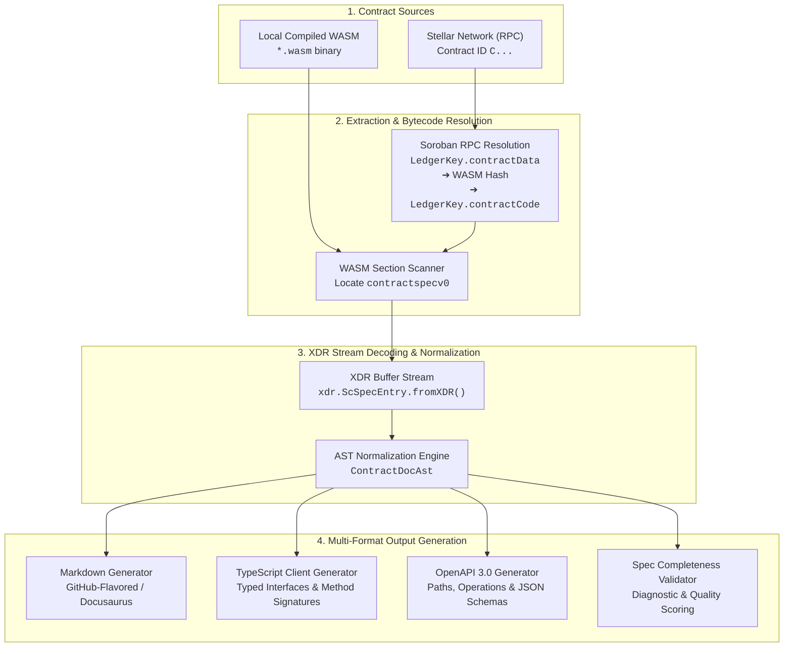

<div align="center">

# @sorodoc/sdk

### The Foundational Protocol & Specification Decompiler Engine for Stellar Soroban

[](https://github.com/SoroDoc-Studio/sorodoc-sdk/actions)
[](https://www.npmjs.com/package/@sorodoc/sdk)
[](https://opensource.org/licenses/MIT)
[](https://stellar.org/soroban)
[](https://www.typescriptlang.org/)

**The automated smart contract documentation engine and interactive "Swagger UI" for the Stellar Soroban ecosystem.**

[Overview](#-overview) • [How It Works](#-how-it-works-technical-architecture) • [Installation](#-installation) • [Quickstart](#-quickstart-code-examples) • [API Reference](#-core-api-reference) • [Testing](#-testing) • [Contributing](#-contributing)

</div>

---

## 📖 Overview

Once Soroban smart contracts are compiled to WebAssembly (`.wasm`) and deployed to the Stellar network, frontend engineers, integrators, and security auditors face a steep barrier: **there is no human-readable interface documentation**. Interacting with deployed contracts traditionally requires reverse-engineering Rust source code or manually parsing raw, binary XDR ledger streams.

`@sorodoc/sdk` solves this foundational gap. It serves as the **core decompiler and AST generation engine** for the entire SoroDoc ecosystem. It safely extracts embedded binary metadata from the `contractspecv0` WebAssembly custom section (either from raw local `.wasm` files or fetched directly on-chain via Soroban RPC), decodes sequences of variable-length `ScSpecEntry` XDR records, and normalizes them into a strongly typed, deterministic Abstract Syntax Tree (`ContractDocAst`).

From this AST, `@sorodoc/sdk` produces production-ready Markdown documentation, typed TypeScript client bindings, and compliant OpenAPI 3.0 schemas.

---

## 🏗️ How It Works (Technical Architecture)



### 1. Wasm Binary Custom Section Inspection
Compiled Soroban contracts adhere to the WebAssembly specification and embed custom metadata. During compilation, the Soroban SDK places all exported function definitions, struct types, enum variants, union definitions, and Rust docstrings (`/// ...`) into a dedicated custom section identified by the string **`contractspecv0`**. `@sorodoc/sdk` parses the WASM section headers directly in memory without requiring an active WebAssembly runtime engine.

### 2. On-Chain Resolution via Soroban RPC
When inspecting deployed contracts by Contract ID (`C...`):
1. **Contract Instance Query:** The SDK constructs a `LedgerKey.contractData` query using `ScVal.scvLedgerKeyContractInstance()` to retrieve the instance entry from persistent storage.
2. **Executable Validation:** It verifies the executable format (rejecting built-in Stellar Asset contracts without bytecode specifications) and extracts the 32-byte cryptographic `wasmHash`.
3. **Contract Code Fetch:** It builds a `LedgerKey.contractCode` query for the resolved hash, retrieving the full WASM bytecode directly from the ledger.
4. **Decompilation:** The retrieved bytecode is passed to the parser to extract the `contractspecv0` stream.

### 3. XDR Stream Decoding & AST Normalization
The custom section contains a contiguous stream of variable-length XDR-encoded `ScSpecEntry` structures. The SDK deserializes this stream, handles padding and multi-entry boundaries, and maps XDR union switches into standard TypeScript entities (`ContractDocAst`).

---

## 📦 Installation

Install `@sorodoc/sdk` alongside its peer dependency `@stellar/stellar-sdk`:

```bash
# npm
npm install @sorodoc/sdk @stellar/stellar-sdk

# pnpm
pnpm add @sorodoc/sdk @stellar/stellar-sdk

# yarn
yarn add @sorodoc/sdk @stellar/stellar-sdk
```

---

## 🚀 Quickstart Code Examples

### Example 1: Parsing a Local `.wasm` File Buffer

```typescript
import * as fs from "node:fs";
import { extractSpecFromWasm } from "@sorodoc/sdk";

// 1. Read compiled Soroban contract WASM binary
const wasmBuffer = fs.readFileSync("./target/wasm32-unknown-unknown/release/token.wasm");

// 2. Extract and decompile specification AST
const ast = extractSpecFromWasm(wasmBuffer);

console.log(`Decompiled contract with:`);
console.log(`- ${ast.functions.length} exported functions`);
console.log(`- ${ast.structs.length} user-defined structs`);
console.log(`- ${ast.errors.length} custom error definitions`);
```

### Example 2: Fetching and Parsing an On-Chain Contract by ID

```typescript
import { fetchSpecFromRpc } from "@sorodoc/sdk";

async function inspectLiveContract() {
  const ast = await fetchSpecFromRpc({
    rpcUrl: "https://soroban-testnet.stellar.org",
    contractId: "CDLZFC3SYJYDZT7K67VZ75HPJVIEUVNIXF47ZG2FB2RMQQVU2HHGCYSC",
  });

  for (const fn of ast.functions) {
    console.log(`Function: ${fn.name}(${fn.inputs.map(i => `${i.name}: ${i.type}`).join(", ")}) -> ${fn.outputs[0]?.type ?? "void"}`);
    if (fn.doc) console.log(`  Description: ${fn.doc}`);
  }
}

inspectLiveContract();
```

### Example 3: Generating Markdown and OpenAPI JSON from AST

```typescript
import * as fs from "node:fs";
import { 
  extractSpecFromWasm, 
  generateMarkdown, 
  generateTypeScript, 
  generateOpenApi 
} from "@sorodoc/sdk";

const wasmBytes = fs.readFileSync("./token.wasm");
const ast = extractSpecFromWasm(wasmBytes);

// 1. Generate GitHub-flavored / Docusaurus Markdown
const markdown = generateMarkdown(ast, { contractName: "LiquidityPool" });
fs.writeFileSync("./LiquidityPool.md", markdown);

// 2. Generate TypeScript client bindings
const tsBindings = generateTypeScript(ast, "LiquidityPoolClient");
fs.writeFileSync("./LiquidityPoolClient.ts", tsBindings);

// 3. Generate OpenAPI 3.0 specification schema
const openApiSchema = generateOpenApi(ast, { title: "Liquidity Pool Contract API" });
fs.writeFileSync("./openapi.json", JSON.stringify(openApiSchema, null, 2));
```

---

## 📚 Core API Reference

### Top-Level Exports

| Export | Type | Description |
| :--- | :--- | :--- |
| `extractSpecFromWasm(wasmBytes)` | `Function` | Parses a WebAssembly binary buffer and extracts the normalized `ContractDocAst`. |
| `extractSpecBytesFromWasm(wasmBytes)` | `Function` | Extracts the raw `contractspecv0` section byte buffers from WebAssembly. |
| `fetchSpecFromRpc(options)` | `Function` | Fetches on-chain bytecode via Soroban RPC and decompiles its specification. |
| `generateMarkdown(ast, options?)` | `Function` | Produces comprehensive GitHub-flavored Markdown documentation. |
| `generateTypeScript(ast, clientName?)` | `Function` | Generates strongly typed TypeScript interfaces and contract client definitions. |
| `generateOpenApi(ast, options?)` | `Function` | Generates an OpenAPI 3.0.3 schema representing contract operations. |
| `validateContractSpec(ast, options?)` | `Function` | Validates documentation completeness, docstrings, and identifier integrity. |

---

### Key TypeScript Interfaces

```typescript
/**
 * Root normalized Abstract Syntax Tree (AST) representing a decompiled contract specification.
 */
export interface ContractDocAst {
  functions: FunctionDoc[];
  structs: StructDoc[];
  enums: EnumDoc[];
  unions: UnionDoc[];
  errors: ErrorEnumDoc[];
}

/**
 * Detailed documentation and signature schema for a contract entry point.
 */
export interface FunctionDoc {
  name: string;
  doc?: string;
  inputs: FunctionInputDoc[];
  outputs: TypeDefinitionDoc[];
}

export interface FunctionInputDoc {
  name: string;
  doc?: string;
  type: string;
  typeDef: TypeDefinitionDoc;
}

/**
 * Strongly typed representation of Soroban primitive or user-defined types (UDTs).
 */
export interface TypeDefinitionDoc {
  kind: "primitive" | "udt" | "vec" | "map" | "tuple" | "option" | "result" | "bytes" | "string";
  name?: string;
  elementTypes?: TypeDefinitionDoc[];
  keyType?: TypeDefinitionDoc;
  valueType?: TypeDefinitionDoc;
}

/**
 * Custom error enum mapping numeric contract error codes to Rust variants.
 */
export interface ErrorEnumDoc {
  name: string;
  doc?: string;
  cases: Array<{
    name: string;
    value: number;
    doc?: string;
  }>;
}
```

---

## 🧪 Testing

The test suite validates compatibility against official Soroban protocol reference contracts, compiler outputs, and adversarial WebAssembly inputs:

```bash
# Run unit & fixture tests
npm test

# Run tests in interactive watch mode
npm run test:watch

# Generate code coverage report
npm run test:coverage

# Strict static typecheck
npm run typecheck

# Run linter
npm run lint
```

---

## 🤝 Contributing

We welcome community contributions from protocol developers and Stellar ecosystem builders. Please read our [CONTRIBUTING.md](./CONTRIBUTING.md) and [ARCHITECTURE.md](./ARCHITECTURE.md) guides before submitting pull requests.

---

## 📄 License

This project is licensed under the [MIT License](./LICENSE).
